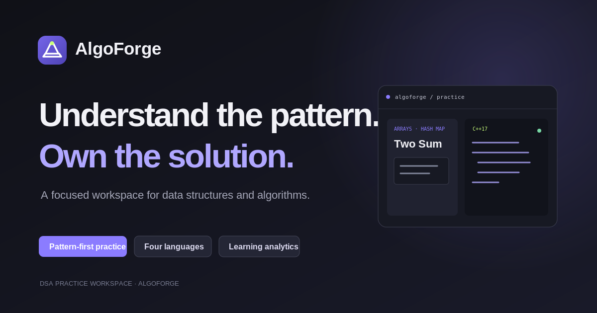
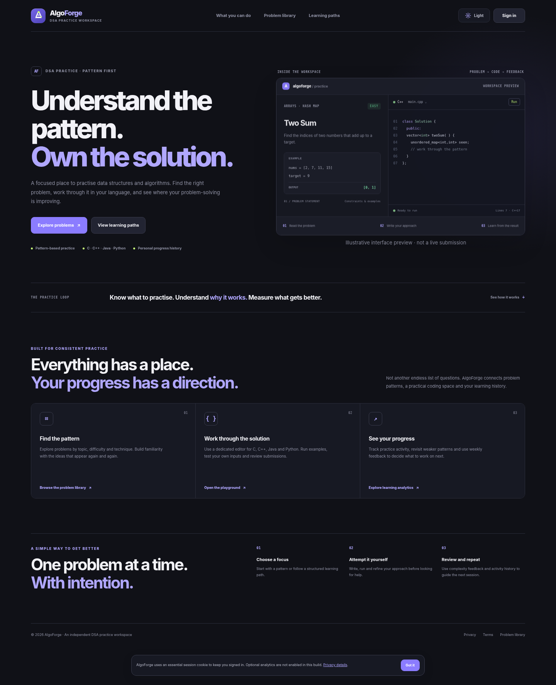
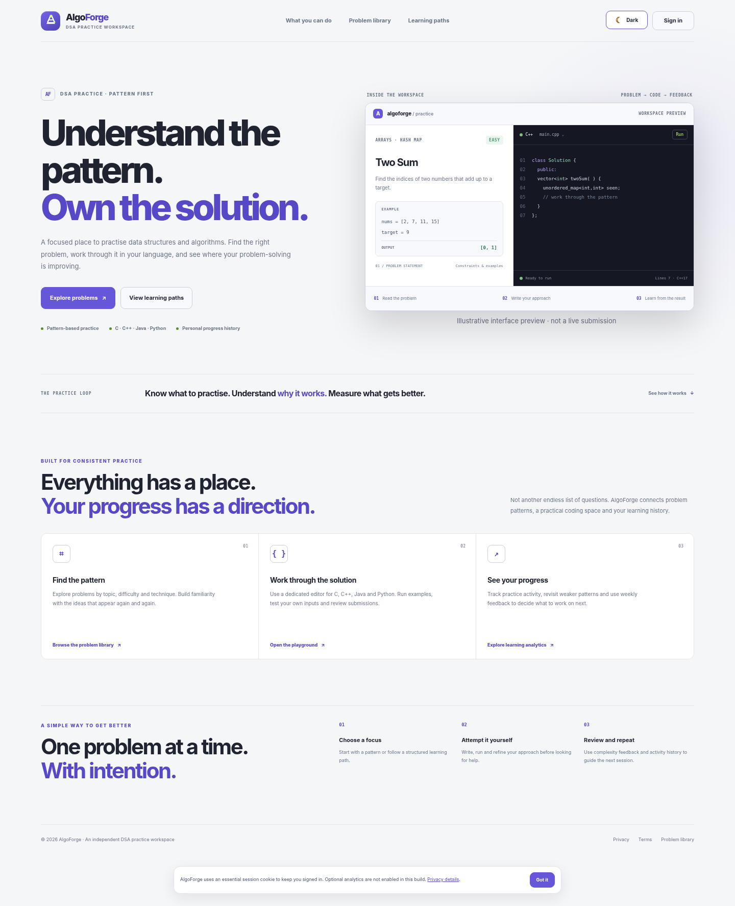
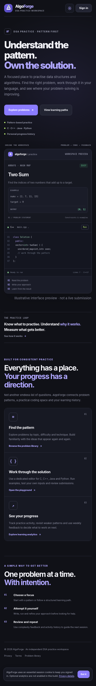
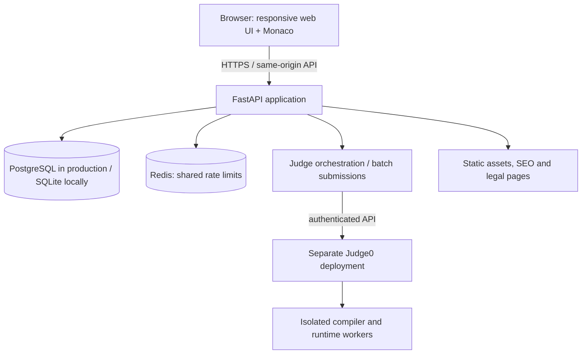

<div align="center">
  

  # AlgoForge

  **A pattern-first environment for learning, practising and mastering algorithms.**

  [](https://www.python.org/)
  [](https://fastapi.tiangolo.com/)
  [](https://www.postgresql.org/)
  [](LICENSE)

  **[Features](#product-overview) · [Architecture](#architecture) · [Quick start](#quick-start) · [Research](docs/RESEARCH.md) · [Contributing](CONTRIBUTING.md) · [Security](SECURITY.md)**
</div>

---

> **Project maturity:** research-backed development release. AlgoForge is runnable locally and has automated tests, but it is **not yet certified or ready for an unrestricted public production launch**. A live isolated judge, deployment-specific security review, operational monitoring, backups/restore drills and load testing are still required. See [release readiness](IMPLEMENTATION_STATUS.md).

## Product overview

AlgoForge brings together the most useful learning workflows found across coding-practice and competitive-programming products, while keeping an independent identity, original judgeable exercises and clear attribution to external sources.

### What is in the application

- **Problem discovery:** searchable, difficulty- and pattern-oriented catalogue with source attribution and official links.
- **Original judged track:** AlgoForge-authored problem statements and platform-owned sample/hidden test cases.
- **Coding workspace:** Monaco editor, C/C++/Java/Python templates, resizable panes, custom input, per-case output, autosave and restorable code history. Seven original problems support trusted function-style execution in all four languages; the remaining original problems use standard input/output.
- **Online judging integration:** backend orchestration to a separately deployed Judge0-compatible service; hidden test data stays server-side.
- **Learning system:** four catalogue-backed DSA tracks with ordered modules, prerequisites, time estimates, question recommendations, progress meters, bookmarks, notes and daily challenge.
- **Progress analytics:** active days, contributions, pattern/topic mastery, weak-area signals, weekly comparison and practice recommendations.
- **Consistency:** activity history, current/longest streaks and achievements.
- **Competition and community:** scheduled contests, registration, scoreboards, problem discussions, replies, voting, reports and moderation.
- **Operations:** FastAPI APIs, SQLAlchemy persistence, Alembic migrations, PostgreSQL/Redis Compose stack, CI and GitHub contribution/security guidance.

### Product screenshots

| Dark landing page | Light landing page | Mobile landing page |
|---|---|---|
|  |  |  |

## Research and product decisions

AlgoForge's product choices are informed by a comparative review of LeetCode, HackerRank, Codeforces, CodeChef, AtCoder, CSES, GeeksforGeeks and community learning roadmaps. The research is a product-design synthesis, not a claim of feature parity or a formal audit of those services.

| Reference product | Workflow worth learning from | AlgoForge interpretation |
|---|---|---|
| LeetCode | Interview practice, function-style editor, custom tests and submission history | Focused problem workspace and separate Run/Submit actions |
| Codeforces | Tag-driven competitive programming, rating context and contests | Pattern/tag discovery, rating-aware metadata and contest roadmap |
| CodeChef | Problem-setting discipline and contest formats | Original problem authoring checklist and contest workflow |
| AtCoder | Contest progression and algorithmic practice | Contest-oriented learning path and source links |
| CSES | Coherent topic-based problem progression | Topic-first roadmap structure |
| HackerRank | Structured skills and language practice | Language selection and guided practice tracks |
| GeeksforGeeks / NeetCode-style roadmaps | Topic explanations and pattern-led preparation | Pattern taxonomy and revision paths |

**Research-derived constraints:**

1. A public GitHub repository is not automatically a redistribution licence. Each imported dataset or code asset needs provenance and licence review.
2. LeetCode's Terms restrict scraping/crawling and protect platform content. AlgoForge therefore uses source links and limited metadata rather than mirroring statements, editorials or hidden tests without permission.
3. Codeforces documents an official `problemset.problems` API and a request limit of one call per two seconds. The importer is deliberately low-volume and metadata-only.
4. A successful compiler run is not an Accepted verdict. An Accepted verdict requires an authorised test suite and server-side judging.
5. Complexity estimates and measured runtime are different evidence. AlgoForge labels heuristic estimates as estimates and reports measured execution metrics separately.

Read the full [research report](docs/RESEARCH.md), [platform comparison](docs/PLATFORM_COMPARISON.md), [data licensing policy](docs/DATA_LICENSING.md), [learning-path design](docs/LEARNING_PATHS.md), [0.8.0 release record](docs/RELEASE_0.8.0.md) and [architecture decision record](docs/architecture/decisions.md).

## Current catalogue and judging scope

The included seed has **159 records**: 140 third-party metadata/link entries and 19 original AlgoForge problems. The 19 original problems have 77 platform-owned sample/hidden test cases. Seven of the original problems currently expose tested function-signature adapters in C, C++, Java and Python.

| Source | Seed records | What is stored |
|---|---:|---|
| LeetCode | 102 | Curated metadata and canonical source links |
| CSES | 16 | Curated metadata and canonical source links |
| Codeforces | 10 | Curated metadata and canonical source links |
| HackerRank | 5 | Curated metadata and canonical source links |
| AtCoder | 4 | Curated metadata and canonical source links |
| CodeChef | 3 | Curated metadata and canonical source links |
| AlgoForge originals | 19 | Original statements and owned test cases |
| **Total** | **159** | |

The 500-question target (150 Easy / 250 Medium / 100 Hard) is a **catalogue target, not a claim that 500 questions are natively judged by AlgoForge**. The included Codeforces importer can expand the metadata catalogue from the official API. It has not been run in this packaged offline environment. External problems link to their source platform; their statements, editorials and private tests are not rehosted.

```bash
# Read-only preview first (no catalogue rows are inserted)
python scripts/import_codeforces.py --report reports/codeforces-import-plan.json

# Review the JSON plan, then explicitly apply it
python scripts/import_codeforces.py --apply --report reports/codeforces-import-applied.json

# Audit the current catalogue without modifying it
python scripts/audit_catalogue.py --report reports/catalogue-audit.json
```

The importer defaults to a dry run; only `--apply` writes records. The audit checks required metadata, difficulty values, topic tags, HTTPS source links, duplicate slugs and third-party content/provenance boundaries. `--strict` makes the audit exit non-zero when it finds any warning or error. The importer maps Codeforces ratings into AlgoForge's own difficulty buckets (Easy ≤1100, Medium 1101–1800, Hard >1800). These are application-side heuristics, not universal or official equivalences. Review imported records before presenting them as a curated learning sequence.

## Architecture



### Technology

| Layer | Technology | Responsibility |
|---|---|---|
| Web UI | HTML, CSS, JavaScript, Monaco Editor | Responsive SPA, editor and interaction |
| API | Python, FastAPI, Uvicorn | Authentication, business rules and API |
| Persistence | SQLAlchemy, PostgreSQL / SQLite | Users, problems, activity, submissions and contests |
| Migrations | Alembic | Versioned database schema |
| Rate limiting | Redis (production) | Shared request throttling |
| Code execution | Judge0 CE-compatible service | Isolated compilation and execution outside the web process |
| Local orchestration | Docker Compose | Web, PostgreSQL, Redis and optional Caddy |
| Quality | pytest, Node syntax check, GitHub Actions | Regression checks and CI |

Learning-path modules are resolved against the real catalogue using explicit pattern/topic selectors. User progress is based on existing recorded problem states, prerequisites unlock at 60% mastery, and the UI exposes catalogue gaps. See [learning-path design](docs/LEARNING_PATHS.md).

The current frontend is a lightweight static SPA served by FastAPI. Public landing/legal content is server-delivered; authenticated views are not full per-route SSR. This is an intentional current architecture boundary, not an unfulfilled claim hidden in the feature list.

## Quick start

### Requirements

- Python 3.11 or newer (Python 3.12 is used in the container image).
- Git and VS Code (recommended).
- Node.js 22 only for the frontend JavaScript syntax check; it is not needed to run the app.
- Docker Desktop only if using the Compose deployment.

### Windows / VS Code

1. Download or clone the repository.
2. Open the `algoforge` folder in VS Code.
3. Open **Terminal → New Terminal**.
4. Run the helper:

```powershell
.\run_local.ps1
```

Or perform the setup manually:

```powershell
py -m venv .venv
.\.venv\Scripts\Activate.ps1
pip install -r requirements-dev.txt
Copy-Item .env.example .env
alembic upgrade head
uvicorn app.main:app --reload --host 127.0.0.1 --port 8000
```

Open <http://localhost:8000>.

A development-only demo account is created automatically when enabled by the app configuration:

```text
Email:    demo@algoforge.dev
Password: demo-pass-123
```

Change or disable demo credentials before sharing a development environment. The demo account is not created in production mode.

### Docker Compose

Copy `.env.example` to `.env`, set distinct strong `POSTGRES_PASSWORD` and `REDIS_PASSWORD` values, and run:

```bash
docker compose up --build -d
```

The web service binds to `127.0.0.1:8000`. For the optional Caddy profile, configure a real domain, DNS and production environment first; do not expose the default development configuration to the internet.

## Configure the online judge

The web application does **not** execute arbitrary submissions itself. It sends source code to a separately operated Judge0-compatible service using a backend-held token. For local UI/API development, judge functionality may remain unconfigured; the app must report that state rather than simulate an Accepted result.

Before enabling public submissions:

1. Deploy a dedicated judge service on isolated infrastructure.
2. Review its version, image provenance, sandbox settings, kernel/cgroup limits and network egress policy.
3. Configure authentication and TLS.
4. Verify language IDs against the actual judge instance.
5. Run end-to-end tests for C, C++, Java and Python, including timeout, memory, compile error and malicious workload cases.
6. Set per-user and global queue limits, quotas, monitoring and cleanup.

See [Judge0 deployment and threat model](docs/JUDGE0_DEPLOYMENT.md). The public shared Judge0 endpoint is not an appropriate production dependency for a public multi-user judge.

## Development and quality checks

```bash
# Install development dependencies
pip install -r requirements-dev.txt

# Install a Chromium browser for Playwright end-to-end checks
python -m playwright install chromium

# Database schema
alembic upgrade head

# Backend tests
pytest -q

# Read-only catalogue quality audit
python scripts/audit_catalogue.py

# Python syntax
python -m compileall -q app scripts migrations

# Frontend syntax (Node.js 22 recommended)
node --check app/static/app.js
```

CI runs Python compilation, clean SQLite migration, pytest (including three Playwright browser smoke tests with Chromium) and frontend syntax checks. The current local managed browser environment blocks browser navigation to localhost, so those three end-to-end tests are skipped locally and are intended to execute on the GitHub Actions runner. A passing test suite does not replace a live judge test, a full WCAG audit, load test or independent security assessment.

## Repository map

```text
algoforge/
├── app/
│   ├── main.py                  # FastAPI routes, persistence, auth and judge orchestration
│   ├── native_problems.py       # Original problem statements and test suites
│   ├── learning_paths.py        # Version-controlled path/module curriculum
│   ├── seed_data.py             # Curated external metadata/link catalogue
│   └── static/                  # SPA, design system, favicon and social preview
├── migrations/                  # Alembic migrations
├── scripts/                     # Source metadata importers
├── tests/                       # API, auth, judging, importer and analytics tests
├── docs/
│   ├── architecture/            # Architecture decisions and threat model
│   ├── screenshots/             # UI review captures
│   ├── RESEARCH.md
│   ├── PLATFORM_COMPARISON.md
│   ├── DATA_LICENSING.md
│   ├── LEARNING_PATHS.md
│   ├── RELEASE_0.8.0.md
│   └── JUDGE0_DEPLOYMENT.md
├── .github/                     # CI, security scanning and contribution templates
├── deploy/                      # Caddy reverse proxy configuration
├── Dockerfile
├── docker-compose.yml
├── run_local.ps1
├── requirements*.txt
├── README.md
├── CONTRIBUTING.md
├── SECURITY.md
└── LICENSE
```

## API surface

The FastAPI application exposes routes for authentication, catalogue browsing, user progress, analytics, drafts/version history, code execution, judged submissions, contests, discussions/moderation and operational health. In development, interactive API documentation is available at `/api/docs`.

Core route groups include:

- `/api/auth/*`, `/api/me`
- `/api/problems`, `/api/platforms`, `/api/patterns`, `/api/roadmaps`
- `/api/dashboard`, `/api/analytics`, `/api/achievements`
- `/api/drafts/*`, `/api/run/*`, `/api/submissions/*`
- `/api/contests/*`, `/api/problems/{slug}/discussions`
- `/api/admin/*`, `/api/health`, `/api/judge/*`
- `/robots.txt`, `/sitemap.xml`

## GitHub workflow

- Read [CONTRIBUTING.md](CONTRIBUTING.md) before opening a PR.
- Use the issue templates for bugs and feature requests.
- Never commit `.env`, database files, credentials, user data or third-party problem content.
- Add an Alembic migration for schema changes and regression tests for behavior changes.
- Keep imported content provenance and licence notes.
- Use private vulnerability reporting; see [SECURITY.md](SECURITY.md).

## Roadmap

- [ ] Execute and review the 500-metadata import on a network-enabled runner; publish the real source/difficulty distribution.
- [ ] Expand original problem coverage and test-suite quality review.
- [ ] Complete live dedicated Judge0 validation and operational monitoring.
- [ ] Add email verification, password recovery and MFA.
- [x] Add Playwright browser E2E smoke tests for learning paths, theme persistence, mobile overflow and new function-mode workspace controls.
- [ ] Run a full WCAG 2.2 accessibility audit and remediate findings.
- [ ] Run OWASP ASVS-aligned security verification, load tests and restore drills.
- [ ] Measure production Core Web Vitals after deployment.
- [ ] Evaluate a typed, server-rendered frontend migration only if product needs justify the additional complexity.

## Licence and acknowledgements

The original AlgoForge application code is licensed under the [MIT License](LICENSE). Third-party packages, problem metadata, source links, trademarks, logos and any externally sourced content remain subject to their own licences and terms. The MIT licence does not grant rights to third-party problem statements, test data or platform branding. See [THIRD_PARTY_NOTICES.md](THIRD_PARTY_NOTICES.md) and [docs/DATA_LICENSING.md](docs/DATA_LICENSING.md).

AlgoForge is an independent project and is not affiliated with or endorsed by LeetCode, HackerRank, Codeforces, CodeChef, AtCoder, CSES or GeeksforGeeks.
