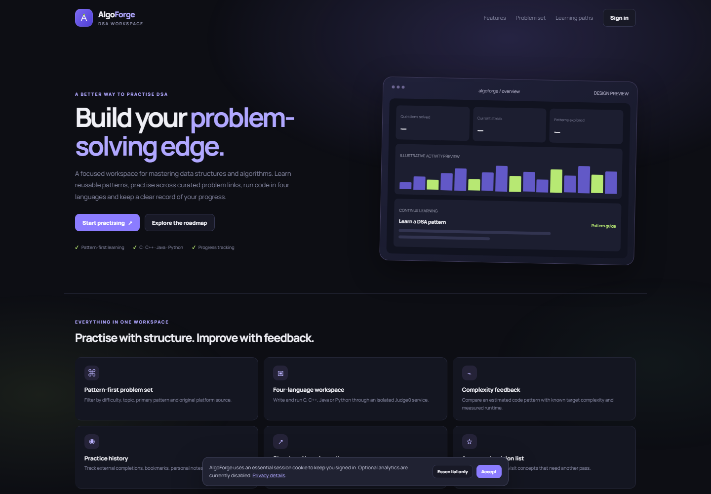
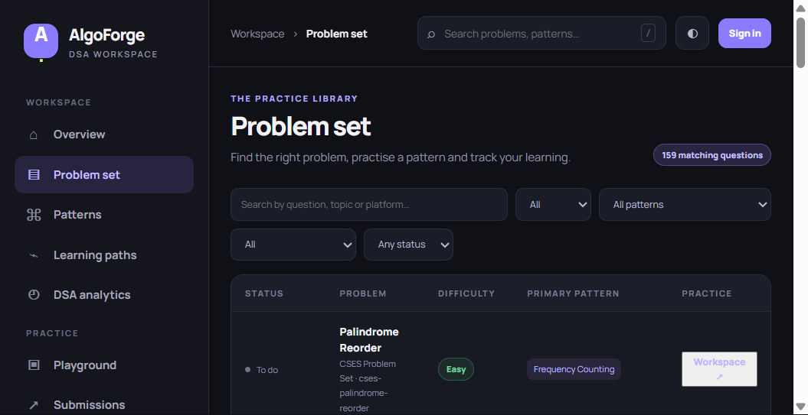
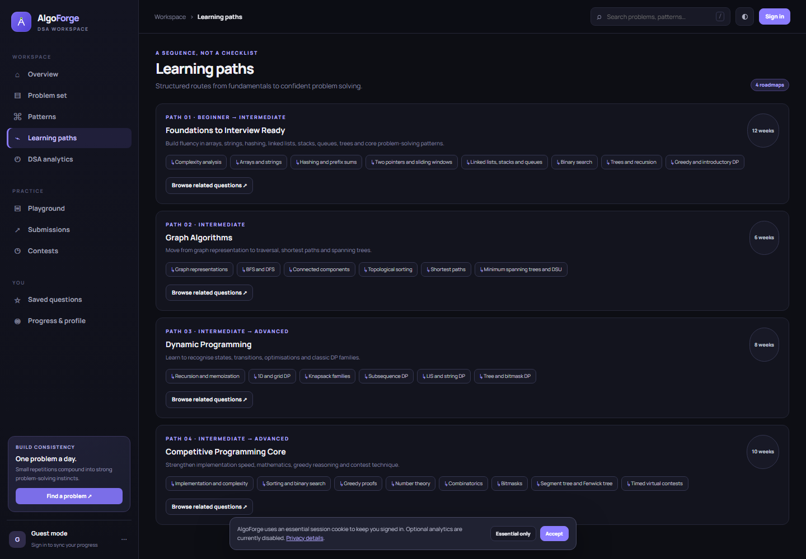
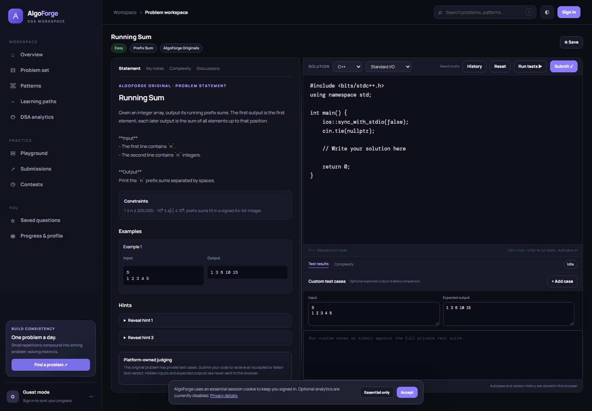

# AlgoForge

[](https://github.com/KisholoyDD21/AlgoForge/actions/workflows/ci.yml)
[](https://www.python.org/)

AlgoForge is an independent, pattern-first workspace for studying data structures and algorithms. It brings together a searchable, source-linked question catalogue, original exercises, a coding workspace, progress tracking, learning paths, and scheduled practice contests.

> **Project status:** AlgoForge is a development-stage application, not a deployed or security-certified public service. The included production configuration is a starting point for an operator to harden and validate. Complete the [production readiness checklist](IMPLEMENTATION_STATUS.md) before inviting public users.

## Screenshots

| Landing page | Problem library |
|---|---|
|  |  |

| Learning paths | Coding workspace |
|---|---|
|  |  |

Screenshots are representative UI captures. Code execution requires a reachable, compatible Judge0 service; the production Judge0 deployment is not included in this repository.

## Features

- **Problem discovery:** search and filter by difficulty, topic, pattern, source platform, and progress.
- **Pattern-first learning:** reusable DSA patterns, learning paths, daily challenges, and recommendations.
- **Coding workspace:** C, C++, Java, and Python templates; Monaco editor with a text-editor fallback; custom input/output cases; and resizable statement/editor panes.
- **Code drafts:** browser autosave for guests; user-scoped synchronization and version history for signed-in accounts.
- **Original problem judging:** asynchronous submissions against platform-owned tests through a separately deployed Judge0-compatible service. Hidden tests are not sent to the browser.
- **Progress and analytics:** solved status, activity, streaks, bookmarks, notes, achievements, pattern/topic mastery, weekly reports, and cautious completion-pace estimates.
- **Contests and community:** scheduled contests, scoreboards, problem discussions, replies, votes, reports, and admin moderation.
- **Administration:** protected problem and contest authoring, moderation, and safeguards for content with existing submissions or learner progress.
- **Operations foundation:** FastAPI, SQLAlchemy, Alembic migrations, SQLite for local development, PostgreSQL and Redis for production, Docker Compose, optional Caddy TLS, and GitHub Actions CI.

The application does not reproduce third-party problem statements or claim official integrations with those platforms. See [catalogue and content boundaries](#catalogue-and-content-rights).

## Contents

- [Requirements](#requirements)
- [Run locally](#run-locally)
- [Run with Docker Compose](#run-with-docker-compose)
- [Production deployment](#production-deployment)
- [Configuration](#configuration)
- [Catalogue and content rights](#catalogue-and-content-rights)
- [Code execution and judging](#code-execution-and-judging)
- [Tests and checks](#tests-and-checks)
- [Health checks and API](#health-checks-and-api)
- [Security, privacy, and operations](#security-privacy-and-operations)
- [Project structure](#project-structure)
- [Contributing and support](#contributing-and-support)
- [License](#license)

## Requirements

For local development:

- Python 3.11 or later (CI and the container image use Python 3.12).
- Git.
- Windows PowerShell on Windows; a POSIX-compatible shell on macOS/Linux.
- Optional: Node.js 22 to run the frontend JavaScript syntax check.

For Docker:

- Docker Engine and the Docker Compose v2 plugin.

For real code execution, configure a separate Judge0 CE-compatible service. It is not bundled with the application Compose stack.

## Run locally

### Windows PowerShell

From the repository directory:

```powershell
.\run_local.ps1
```

The helper creates `.venv`, installs development dependencies, copies `.env.example` to `.env` if needed, applies database migrations, and starts the development server on `127.0.0.1:8000`.

If your PowerShell execution policy blocks the helper, run it with a process-scoped policy override:

```powershell
powershell -NoProfile -ExecutionPolicy Bypass -File .\run_local.ps1
```

Or manage setup manually:

```powershell
py -3 -m venv .venv
.\.venv\Scripts\Activate.ps1
python -m pip install -r requirements-dev.txt
Copy-Item .env.example .env
python -m alembic upgrade head
python -m uvicorn app.main:app --reload --host 127.0.0.1 --port 8000
```

### macOS and Linux

```bash
python3 -m venv .venv
source .venv/bin/activate
python -m pip install -r requirements-dev.txt
cp .env.example .env
python -m alembic upgrade head
python -m uvicorn app.main:app --reload --host 127.0.0.1 --port 8000
```

Open [http://127.0.0.1:8000](http://127.0.0.1:8000). The API documentation is available at [http://127.0.0.1:8000/api/docs](http://127.0.0.1:8000/api/docs) in development mode only.

In development, the app creates a demo account:

```text
Email:    demo@algoforge.dev
Password: demo-pass-123
```

This account is never created in production. Do not reuse these credentials or development secrets outside a local environment. The `.env` file and local SQLite database are ignored by Git; keep them that way.

The development environment template points at the public shared Judge0 CE endpoint as a convenience. Code and standard input you submit there leave your machine and are handled by a third party. Do not send sensitive or proprietary code to that endpoint. Set `JUDGE0_URL` to an empty value to disable execution until you have a service you control.

## Run with Docker Compose

Create the environment file and replace the database and Redis placeholders with **different** strong, random secrets:

```bash
cp .env.example .env
```

Then start the local stack:

```bash
docker compose up --build -d
docker compose ps
docker compose logs -f web
```

The default profile starts the app, PostgreSQL, and password-protected Redis. The web service is bound to `127.0.0.1:8000`; it is not published on every network interface. Open [http://127.0.0.1:8000](http://127.0.0.1:8000).

Stop the services with `docker compose down`. Add `--volumes` only if you intentionally want to delete the persistent PostgreSQL data.

## Production deployment

The provided Compose configuration is for a Linux host with Docker Compose v2. It is not a managed hosting deployment or a substitute for an operations/security review.

### Before deployment

1. Use a maintained Linux host, review the Docker images and dependencies, and create a staging environment.
2. Point the production DNS name to the host. Allow inbound TCP ports 80 and 443 for Caddy's certificate and HTTPS traffic.
3. Generate unique secrets for PostgreSQL, Redis, the first administrator, and Judge0 authentication. Keep them in a secret manager or protected deployment environment, not in source control.
4. Configure a dedicated HTTPS Judge0 service. Restrict its network access and worker egress; do not run untrusted submissions inside the AlgoForge API container.
5. Complete every applicable item in [IMPLEMENTATION_STATUS.md](IMPLEMENTATION_STATUS.md), review [SECURITY.md](SECURITY.md), and follow the [Judge0 deployment and security runbook](docs/JUDGE0_DEPLOYMENT.md).

### Required production configuration

Set at least the following values in the server's environment or protected `.env` file. Values shown below are placeholders, not usable secrets:

```dotenv
APP_ENV=production
PUBLIC_DOMAIN=practice.example.com
PUBLIC_BASE_URL=https://practice.example.com
COOKIE_SECURE=true

POSTGRES_PASSWORD=<unique-long-random-secret>
REDIS_PASSWORD=<different-unique-long-random-secret>

BOOTSTRAP_ADMIN_EMAIL=admin@example.com
BOOTSTRAP_ADMIN_PASSWORD=<unique-password-of-at-least-16-characters>

JUDGE0_URL=https://judge.internal.example
JUDGE0_TOKEN=<server-side-judge0-token>
```

Compose constructs the PostgreSQL and Redis connection URLs from `POSTGRES_PASSWORD` and `REDIS_PASSWORD`. Do not expose those credentials to the browser. Confirm the language IDs against the `/languages` response from your own Judge0 service before accepting submissions.

Start the app, database, Redis, and optional Caddy HTTPS proxy:

```bash
docker compose --profile production up --build -d
docker compose ps
docker compose logs -f web caddy
```

Caddy provisions certificates when DNS and inbound connectivity are correct. Verify the app and judge health endpoints over HTTPS, complete a staging acceptance test, and confirm that backups can be restored before opening the service to users.

Use the bootstrap administrator credentials for the initial setup and store them securely. After setup, remove `BOOTSTRAP_ADMIN_PASSWORD` from the deployment environment and recreate the web service with `docker compose --profile production up -d web` so the running container no longer has the bootstrap secret. Keep the database and Redis private to the Compose network. If deploying outside Compose, configure PostgreSQL, password-authenticated Redis, HTTPS, proxy trust, migrations, and startup health checks explicitly.

### Ongoing operations

- Automate encrypted PostgreSQL backups and perform documented restore drills.
- Monitor application errors, database and Redis availability, disk, CPU/memory, Judge0 queue depth, worker failures, and unusual submission volume.
- Patch the OS, application dependencies, container images, and Judge0/compiler images; rehearse upgrades and rollback in staging.
- Define retention and deletion procedures for accounts, discussions, code drafts, submissions, and Judge0 data.
- Restrict administrative access and rotate secrets after staff changes or suspected exposure.
- Do not treat a successful health check as proof of secure sandboxing, adequate capacity, or legal compliance.

## Configuration

See [.env.example](.env.example) for the full template. Important settings:

| Variable | Purpose | Production requirement |
|---|---|---|
| `APP_ENV` | Selects development or production guards. | Set to `production`. |
| `DATABASE_URL` | SQLAlchemy database connection. | PostgreSQL (`postgresql+psycopg://...`). Compose supplies it from `POSTGRES_PASSWORD`. |
| `POSTGRES_PASSWORD` | PostgreSQL credential used by Compose. | Unique, strong secret. |
| `REDIS_URL` | Shared rate-limit store. | Authenticated Redis URL. Compose builds it from `REDIS_PASSWORD`. |
| `REDIS_PASSWORD` | Redis credential used by Compose. | Unique, strong secret; do not reuse the database password. |
| `PUBLIC_BASE_URL` | Canonical external origin used in links and sitemap. | HTTPS URL. |
| `PUBLIC_DOMAIN` | Hostname used by the optional Caddy profile. | Must resolve to the deployment host. |
| `COOKIE_SECURE` | Secure session-cookie flag. | Production forces secure cookies; serve the site over HTTPS. |
| `SESSION_TTL_DAYS` | Session lifetime; defaults to 7 days. | Choose and document a suitable policy. |
| `BOOTSTRAP_ADMIN_EMAIL` | Email for creating the initial administrator. | Required when no administrator exists. |
| `BOOTSTRAP_ADMIN_PASSWORD` | Initial administrator password. | At least 16 characters; remove after bootstrap. |
| `JUDGE0_URL` | Judge0-compatible API base URL. | Private/contracted HTTPS service; the shared public endpoint is rejected in production. |
| `JUDGE0_TOKEN` | Server-side Judge0 API token. | Required in production; never place it in frontend code. |
| `JUDGE0_LANGUAGE_C`, `JUDGE0_LANGUAGE_CPP`, `JUDGE0_LANGUAGE_JAVA`, `JUDGE0_LANGUAGE_PYTHON` | Compiler runtime IDs. | Verify against the deployed instance's `/languages` response. |
| `JUDGE0_TIMEOUT_SECONDS` | Judge request timeout; defaults to 20 seconds, clamped to 5–60. | Tune to the service and workload. |

Production startup fails closed unless PostgreSQL, HTTPS `PUBLIC_BASE_URL`, authenticated Redis, a non-public HTTPS Judge0 endpoint, and Judge0 authentication are configured. Never commit `.env`, private keys, tokens, database dumps, or user data.

## Catalogue and content rights

The default seed contains **159 records**:

| Source | Records | Stored content |
|---|---:|---|
| LeetCode | 102 | Metadata and official links |
| CSES | 16 | Metadata and official links |
| Codeforces | 10 | Metadata and official links |
| HackerRank | 5 | Metadata and official links |
| AtCoder | 4 | Metadata and official links |
| CodeChef | 3 | Metadata and official links |
| AlgoForge Originals | 19 | Original statements and platform-owned test suites |
| **Total** | **159** | |

The initial difficulty distribution is 59 Easy, 79 Medium, and 21 Hard. A 500-record target (150 Easy / 250 Medium / 100 Hard) is an optional catalogue goal, **not the current seed size**. The importer can add public Codeforces metadata:

```bash
python scripts/import_codeforces.py
# Or, with the Compose stack running:
docker compose exec web python scripts/import_codeforces.py
```

It uses the official Codeforces problemset API, skips existing slugs, and does not copy statements, examples, editorials, or private tests. Difficulty buckets are AlgoForge classifications based on rating, not labels endorsed by the source platforms. Review API terms and usage limits before importing or scheduling repeated requests.

Third-party entries are discovery links only. Original statements, examples, and judging tests remain with their respective platforms unless AlgoForge has explicit rights to host them. Read [docs/DATA_LICENSING.md](docs/DATA_LICENSING.md); that guidance is not legal advice.

## Code execution and judging

AlgoForge sends source code and selected input to a separately operated Judge0-compatible service. The API does not execute learner code inside its own process. The default development template references the public shared CE endpoint for convenience; it is not controlled by AlgoForge and is not suitable as a production service.

Only AlgoForge-original problems have AlgoForge-owned full test suites. Third-party catalogue entries link to their source platforms and cannot earn an AlgoForge Accepted verdict. Hidden case inputs and expected outputs are not returned to clients. A custom case with no expected output is shown as executed, not passed, and never marks a problem solved.

Function-style adapters are available for four original problems—Running Sum, Maximum Pair Sum, Binary Search Index, and Missing Number—in C, C++, Java, and Python. Other problems currently use standard input/output mode.

For production, deploy and secure a dedicated Judge0 CE-compatible service, verify its compiler IDs, configure authentication, and restrict worker network access. The app's requested runtime/resource limits are not a complete host-level sandbox policy. See [docs/JUDGE0_DEPLOYMENT.md](docs/JUDGE0_DEPLOYMENT.md).

## Tests and checks

Run the same core checks used by CI:

```bash
python -m pip install -r requirements-dev.txt
python -m compileall -q app scripts migrations
python -m alembic upgrade head
pytest -q
node --check app/static/app.js
```

The GitHub Actions workflow runs tests, Python compilation, a clean SQLite migration check, and the JavaScript syntax check. The local `alembic upgrade head` command uses the database configured by `DATABASE_URL`; use a disposable database when validating migrations.

## Health checks and API

| Endpoint | Purpose |
|---|---|
| `GET /api/health` | Application/database health and catalogue count. |
| `GET /api/judge/health` | Judge0 configuration and reachability. |
| `GET /api/judge/languages` | Compiler runtimes reported by Judge0. |
| `/api/docs` | Interactive API docs; enabled in development only. |
| `/robots.txt`, `/sitemap.xml` | Search-engine discovery endpoints. |

API groups include authentication, problems and patterns, dashboard and analytics, progress/bookmarks/notes, drafts and version history, code runs and judging, contests, discussions, and administration. The backend routes are defined in [app/main.py](app/main.py). The landing and legal pages are server-delivered; most signed-in views are a client-rendered single-page application, not full server-side rendering.

## Security, privacy, and operations

- Never expose Judge0 worker services or the database to untrusted networks. Never run submissions inside the AlgoForge web container.
- Treat user code and standard input as untrusted data. Do not submit secrets or confidential code to the public shared Judge0 endpoint.
- Use HTTPS, authenticated Redis, unique secrets, least-privilege access, patched dependencies, encrypted backups, and tested recovery procedures.
- The included Privacy and Terms pages are draft templates. Operators must add their legal identity, contact details, subprocessors, retention rules, user-rights processes, and jurisdiction-specific terms before launch.
- Email verification, password recovery, OAuth, MFA, customer-support workflows, external platform account synchronization, and production monitoring are not configured in this release.
- In-app analytics are derived from recorded practice activity. Some third-party completions are self-reported, so they are not necessarily verified submissions. Learning completion projections are simple pace estimates, not guarantees or AI predictions.

Review [SECURITY.md](SECURITY.md) for private vulnerability reporting and [IMPLEMENTATION_STATUS.md](IMPLEMENTATION_STATUS.md) for the complete implemented/not-complete list. Do not report vulnerabilities in a public issue before maintainers can investigate; use GitHub's private vulnerability reporting flow where available.

## Project structure

```text
algoforge/
├── app/
│   ├── main.py                 # FastAPI API, database models, auth, Judge0 orchestration
│   ├── native_problems.py      # Original problems and owned tests
│   ├── seed_data.py            # Source-linked third-party metadata
│   └── static/                 # Single-page frontend, styles, and app assets
├── docs/
│   ├── screenshots/            # README product screenshots
│   └── ...                     # Licensing, Judge0, research, and operations docs
├── migrations/                 # Alembic schema migrations
├── scripts/                    # Catalogue import utilities
├── tests/                      # API, auth, judging, analytics, importer, and harness tests
├── deploy/                     # Caddy configuration
├── .github/workflows/          # CI
├── Dockerfile
├── docker-compose.yml
├── run_local.ps1               # Windows development launcher
├── requirements.txt
└── requirements-dev.txt
```

## Contributing and support

Read [CONTRIBUTING.md](CONTRIBUTING.md) before opening a pull request. Include focused tests for behavior changes and avoid adding third-party problem content without a clear right to redistribute it.

- **Bugs and feature requests:** [GitHub Issues](https://github.com/KisholoyDD21/AlgoForge/issues)
- **Security reports:** follow [SECURITY.md](SECURITY.md); use private reporting rather than a public issue.
- **Repository:** [KisholoyDD21/AlgoForge](https://github.com/KisholoyDD21/AlgoForge)

## License

This repository currently has no `LICENSE` file. Until the project owner publishes one, do not assume that repository visibility grants permission to use, modify, or redistribute its code. Check dependency licenses separately.
